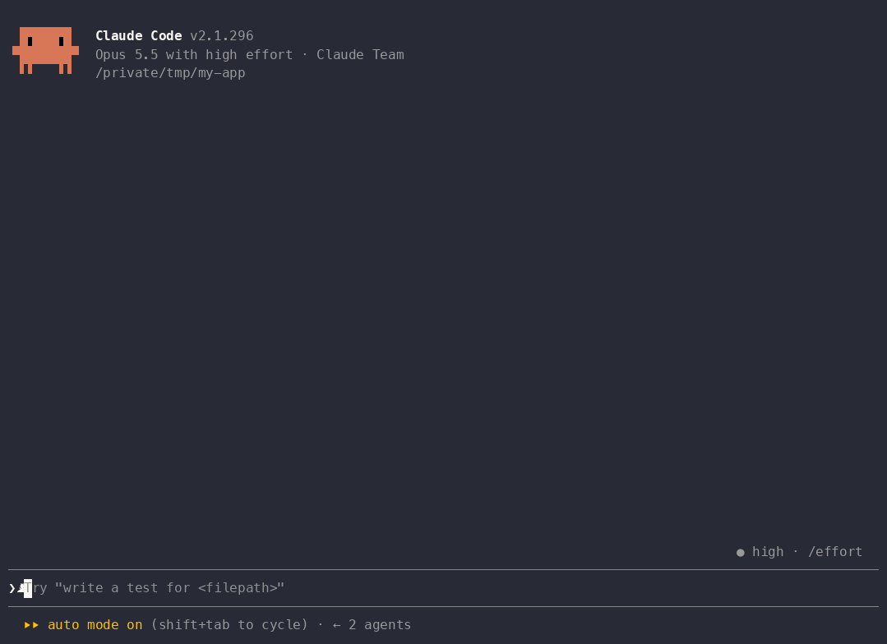
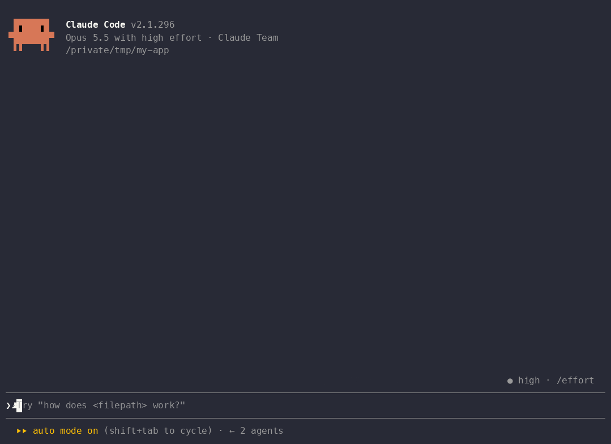
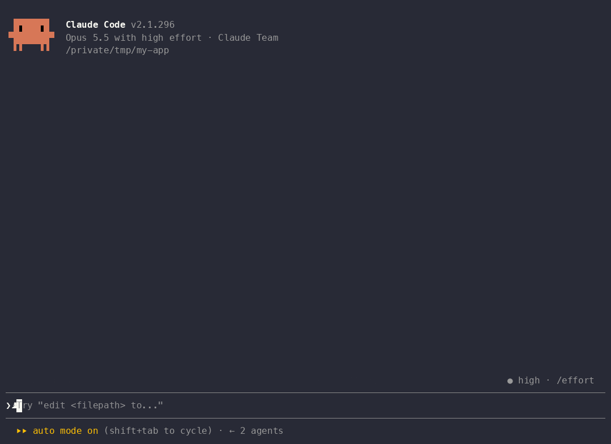
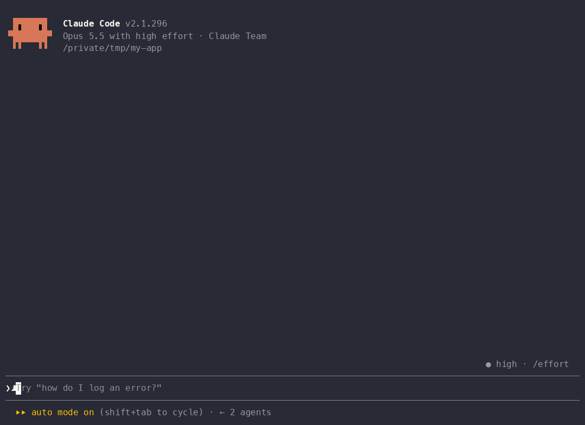
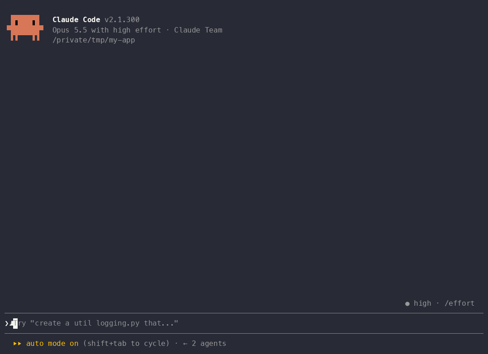

# claude-mods

[](https://github.com/MDmubarak786/claude-mods/actions/workflows/validate.yml)
[](LICENSE)
[](https://code.claude.com/docs/en/plugins/mods/overview)
[](CONTRIBUTING.md)

**Mods add guards, panes, and games to [Claude Code](https://code.claude.com/docs/en/plugins/mods/overview): small plugins that run inside it and can refuse a risky tool call, draw a pane beside the transcript, or add a `/command`, all installed with two commands.**


This repository is a marketplace named **`modhub`**. Every mod in it is reviewed against a public checklist and installs and updates like any other plugin.

> [!IMPORTANT]
> **Mods need Claude Code 2.1.287 or later** in the terminal (`claude --version`). In the Desktop app's Code tab they work from 2.1.286 (enter `/status` and read the **Claude Code** row).
>
> On an older version, or where mods are turned off, nothing a mod adds appears: no pane, no `/command`, no guard, and the dim `mods active` line under the tabs in `/plugin` doesn't name it. To check, run `claude plugin test` in your shell from a directory that isn't a mod: `no hooks module to load` means mods can load, and `hooks modules are turned off here` means `disableAllHooks` in your settings or your organization's policy is blocking them. An organization that allows only its own mods (`allowManagedModsOnly`) refuses yours too, which that command doesn't report. See [Troubleshoot a mod](https://code.claude.com/docs/en/plugins/mods/troubleshoot#check-whether-mods-can-load).

> **Mods run with your permissions and are not sandboxed.** Read [Is this safe?](#is-this-safe) before installing anything, here or anywhere else.

## Start with these three

Add the marketplace once, inside a Claude Code session:

```text
/plugin marketplace add MDmubarak786/claude-mods
```

Or from your shell:

```bash
claude plugin marketplace add MDmubarak786/claude-mods
```

Then install the three guards that stop the mistakes that cost the most:

| Install | What it stops |
| :-- | :-- |
| `/plugin install fence@modhub` | Claude editing files outside the paths you named, as in `/fence src/` |
| `/plugin install tripwire@modhub` | An edit, command, or commit that would send an API key, private key, or credential off the machine |
| `/plugin install pkg-guard@modhub` | Installs of packages that don't exist, were published days ago, or are barely downloaded: hallucinated names and typosquats |

Run `/reload-plugins`, then `/plugin`: its `mods active` line names the three.

## Play while Claude works

Nine games that open in a pane beside the transcript, so you can play while a long turn runs. They never call the model, so they cost **zero tokens**.

| Game | Command | What it is |
| :-- | :-- | :-- |
| [`bingo`](mods/bingo/) | `/bingo` | 75-ball bingo against Claude |
| [`xo`](mods/xo/) | `/xo` | Tic-tac-toe, three levels up to perfect |
| [`connect-four`](mods/connect-four/) | `/connect-four` | Connect Four, three levels |
| [`dino`](mods/dino/) | `/dino` | The Chrome dinosaur runner, jump the cacti as the ground speeds up |
| [`game-2048`](mods/game-2048/) | `/2048` | 2048 with one undo and a best score |
| [`pairs`](mods/pairs/) | `/pairs` | Memory pairs on a running clock, fewest turns and fastest time kept |
| [`snake`](mods/snake/) | `/snake` | Snake, steered with w a s d |
| [`sudoku`](mods/sudoku/) | `/sudoku` | Sudoku with one solution per puzzle, three levels, a clock and hints |
| [`typing`](mods/typing/) | `/typing` | A typing race on lines of code, wpm and accuracy |

<table>
<tr>
<td></td>
<td></td>
<td></td>
</tr>
<tr>
<td></td>
<td></td>
<td></td>
</tr>
<tr>
<td></td>
</tr>
</table>

Install one the same way, for example `/plugin install snake@modhub`.

## Install

Inside a Claude Code session (v2.1.287 or later):

```text
/plugin marketplace add MDmubarak786/claude-mods
/plugin install fence@modhub
```

Or from your shell:

```bash
claude plugin marketplace add MDmubarak786/claude-mods
claude plugin install fence@modhub --scope user
```

Run `/reload-plugins` in any session that was already open. To remove a mod, run `/plugin uninstall fence@modhub`. To get updates automatically, open `/plugin`, go to **Marketplaces**, select `modhub`, and enable auto-update.

Try a mod for one session without installing it:

```bash
git clone https://github.com/MDmubarak786/claude-mods.git
cd claude-mods
claude --plugin-dir ./mods/fence
```

## Mods

<!-- mods:start -->
<!-- These tables are generated from .claude-plugin/marketplace.json by scripts/update-readme.mjs. Do not edit by hand. -->

### Guards

| Mod | What it does | Version |
| :-- | :-- | :-- |
| [`circuit-breaker`](mods/circuit-breaker/) | Stop Claude from retrying the same failing shell command over and over. After N identical failures the next attempt is held, and you choose: stop, or try once more. | 0.1.0 |
| [`fence`](mods/fence/) | Limit which paths Claude may edit in a project with one /fence command. Edits outside the fence are refused with a reason Claude can act on. | 0.1.2 |
| [`pkg-guard`](mods/pkg-guard/) | Hold npm, pnpm, yarn, pip, uv, and cargo installs of packages that don't exist, are brand new, or are barely downloaded, with the registry facts in the question. Catches hallucinated and typosquat packages before they land. | 0.1.1 |
| [`tripwire`](mods/tripwire/) | Stop secrets leaving the machine. Holds an edit or command that writes an API key, a private key, or a credential literal, a command that reads a secret file and talks to the network, and a git commit whose staged changes contain a secret. Refuses by default. | 0.1.0 |
| [`undo-agent`](mods/undo-agent/) | Undo the file edits a subagent made. /rewind restores your own turns, but not a subagent's edits; this snapshots them and puts the files back with one command. | 0.1.1 |

### Workflow and context

| Mod | What it does | Version |
| :-- | :-- | :-- |
| [`big-output`](mods/big-output/) | Keep huge shell output out of the context window. A Bash result over a threshold is saved to a file and Claude gets its head and tail plus a slice tool to grep or page the rest on demand. | 0.1.0 |
| [`copy-last`](mods/copy-last/) | Copy Claude's last reply, or its last code block, to the clipboard as clean Markdown with /copy, with no terminal indentation or trailing spaces. | 0.1.0 |
| [`ding`](mods/ding/) | Play a sound and post a desktop notification when Claude finishes a turn or needs you to answer a question or a permission prompt. | 0.1.0 |
| [`mcp-diet`](mods/mcp-diet/) | Choose which MCP tools and subagent types Claude sees, per project. A pane lists every server and tool with the size of its description; defer or hide the ones this repo never needs and stop paying for them on every request. | 0.1.0 |
| [`memory-lint`](mods/memory-lint/) | Know whether your auto-memory index loaded whole. Reports the index's size against a limit you set at every session start, names the entries past the cut, and warns when a session pushes it over. | 0.1.0 |
| [`pins`](mods/pins/) | Pin instructions that survive compaction, /clear, and restarts. /pin saves a rule for this project and every prompt carries the pinned list as context Claude reads. | 0.1.0 |
| [`red-green`](mods/red-green/) | Run the project's tests after any turn that edited files, print pass or fail under Claude's answer, and send the failure back to Claude with one /fix command. | 0.1.1 |
| [`right-tool`](mods/right-tool/) | Stop Claude using cat, grep, find, and sed in Bash when the Read, Grep, and Glob tools fit. Each redirected call saves a permission prompt and keeps raw shell output out of context. | 0.1.0 |
| [`show-paths`](mods/show-paths/) | Put the file path on every Read, Edit, Write, Glob, and Grep row in the transcript, so you never expand a row just to learn which file it touched. | 0.1.0 |
| [`standup`](mods/standup/) | Your day, written for you. Every turn is logged; /standup turns today's work across every session on the machine into a three-bullet update, or a Markdown file. | 0.1.0 |
| [`style-cop`](mods/style-cop/) | Enforce the style rules Claude keeps ignoring: banned words and phrases, a comment-density cap on added code, and files that must not gain comments. Rules live in .claude/style-cop.md and are both shown to Claude and enforced on edits. | 0.1.0 |
| [`trust-but-verify`](mods/trust-but-verify/) | Check what Claude claims against what it ran. When an answer says the tests pass, the build is clean, or something was committed, a line under it says whether a matching command actually ran this turn and succeeded. | 0.1.0 |
| [`watchtower`](mods/watchtower/) | One line above the prompt showing what your guard mods are doing: the fence, pins, the breaker threshold, the test command and its last result, and every call refused this session. | 0.1.0 |

### Games

| Mod | What it does | Version |
| :-- | :-- | :-- |
| [`bingo`](mods/bingo/) | Classic 75-ball bingo, you against Claude. Numbers are called, you mark your card and shout Bingo first; Claude plays a card of its own and claims one call late, so you get a fair window. Zero tokens. | 0.1.1 |
| [`connect-four`](mods/connect-four/) | Connect Four against Claude, in a pane. Press a column's digit to drop a disc; Claude answers in half a second at three levels, from beatable to a seven-move lookahead. Zero tokens. | 0.1.1 |
| [`dino`](mods/dino/) | The Chrome dinosaur runner in a pane. Press w to jump the cacti; the ground speeds up as you go, and your best distance is kept. Zero tokens. | 0.1.0 |
| [`game-2048`](mods/game-2048/) | 2048 in a pane. Slide tiles with w, a, s and d, merge equal numbers, reach 2048. One undo, a best score that survives restarts, and a board that replays from its seed. Zero tokens. | 0.1.1 |
| [`pairs`](mods/pairs/) | Memory pairs in a pane. Sixteen face-down cards, eight matching pairs; press a card's letter to turn it, find its twin, finish in as few turns and as little time as you can. Best of each kept. Zero tokens. | 0.1.1 |
| [`snake`](mods/snake/) | Snake in a pane. Steer with w, a, s and d, eat the food, don't hit the walls or yourself. Pause with p, pick the speed, high score kept. Zero tokens. | 0.1.0 |
| [`sudoku`](mods/sudoku/) | Sudoku in a pane. Three levels with one solution each, move with w a s d, type a digit, undo, a hint when stuck, and a clock that pauses when the pane closes. Best time per level kept. Zero tokens. | 0.1.0 |
| [`typing`](mods/typing/) | Typing race in a pane. A line of code appears, you type it; every character colors right or wrong as you go, and Enter scores words per minute and accuracy. Last ten runs and your best kept. Zero tokens. | 0.1.1 |
| [`xo`](mods/xo/) | Tic-tac-toe against Claude, in a pane. Press a digit to play a square; Claude answers in half a second at three levels, from beatable to perfect. Zero tokens. | 0.1.0 |
<!-- mods:end -->

Looking for something that isn't here yet? The [roadmap](docs/roadmap.md) lists mods we'd love to merge, each with the events and API calls that make it work.

## Is this safe?

A mod is JavaScript that runs in Claude Code's own process with everything your user account can reach: files, environment variables, network, and the ability to approve tool calls. Treat installing a mod like installing a shell extension from a stranger.

What this repository does about it:

- **Every mod is reviewed against the [review checklist](docs/review-checklist.md)** before it's merged. The checklist is public so you can hold us to it.
- **Every mod's README lists its hooks and calls**, the same lines `claude plugin validate` prints, so you can see what it touches without reading the code.
- **CI runs `claude plugin validate --strict` and `claude plugin test`** on every mod, on every pull request.
- **No mod auto-approves tool calls, reads secrets, or phones home without an explicit, documented opt-in.** See [SECURITY.md](SECURITY.md) for the full policy.

Check any mod yourself before you install it:

```bash
git clone https://github.com/MDmubarak786/claude-mods.git
claude plugin validate ./claude-mods/mods/fence
```

The `hooks:` line lists the events the mod handles and the `calls:` line lists every mods API method it invokes.

## Contribute a mod

```bash
scripts/new-mod.sh my-mod "One sentence saying what it does"
claude --plugin-dir ./mods/my-mod
```

That scaffolds a working mod from [`templates/mod`](templates/mod/), registers it in the marketplace, and validates it. [CONTRIBUTING.md](CONTRIBUTING.md) covers the rest: branches, the README template, tests, version bumps, and what has to pass before merge. Questions go to [Discussions](https://github.com/MDmubarak786/claude-mods/discussions); see [SUPPORT.md](SUPPORT.md).

## Layout

```text
.claude-plugin/marketplace.json   The catalog. One entry per mod.
mods/<name>/                      One complete plugin per directory.
templates/mod/                    What scripts/new-mod.sh copies.
scripts/                          new-mod, try, install, validate, ship, and the checks CI runs.
docs/                             Roadmap, review checklist, and the clips to record (docs/media).
.github/                          CI, labeler, Dependabot, issue forms, PR template, CODEOWNERS.
```

## License

MIT. Each mod carries its own author in its `plugin.json`.
