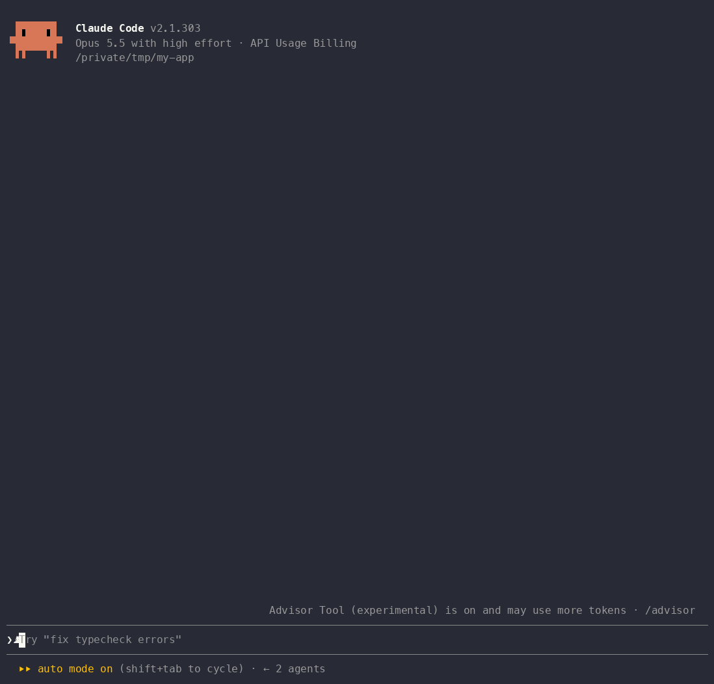

# dino

The dinosaur runner in a pane beside the conversation, the one Chrome shows when the internet is down. Press **w** to jump the cacti. The lane scrolls on a clock while the pane is open and speeds up every 100 points; **p** pauses, Esc closes and pauses, and your best distance survives restarts.

It's a game you play, not a watcher: it never calls a model, never reads what Claude is doing, and costs no tokens. Chrome gave you a dinosaur for when the connection was down; this one is for when Claude is thinking.



*Recorded in a terminal. The Desktop app draws the same pane, with each key shown as a badge.*

```text
DINO  score 00142  HI 00388 · 110 ms
A tall cactus ahead: jump at the last moment to clear it.
┌────────────────────────────────────────────────────────────┐
│                                                            │
│        D                                 #                 │
│. . . . . . . . . . . . . . . . . . . . . # . . . . # # . . │
└────────────────────────────────────────────────────────────┘
w: Jump   p: Pause

n: New game   h: Help   Esc closes and pauses
```

The lane is colored, which the text above can't show: the dinosaur is a `D` on green that turns red when you crash, the cacti are `#` on yellow, and the border turns red at the end of a run. Colors follow your theme.

## Install

```text
/plugin marketplace add MDmubarak786/claude-mods
/plugin install dino@modhub
```

Try it for one session without installing:

```bash
claude --plugin-dir ./mods/dino
```

## How to play

1. Run `/dino`. The pane opens with the dinosaur waiting on the ground. A fresh game shows a short how-to until the first jump; **h** hides or shows it any time.
2. Press **w**, or click Jump. The run starts and the dinosaur leaves the ground at once, rising for two steps, holding, and landing on the fifth. Cacti come at you from the right, one column a step.
3. A small cactus is one cell high and clears under any part of the jump. A tall one is two cells high and only clears at the top of the arc, so jump when it's one to three columns away. The status line warns you when a tall one is next.
4. Every step survived is a point. Every 100 points the steps get 10 ms faster, from 120 ms down to 60 ms at 600.
5. Hitting a cactus ends the run. A toast says the score and whether it's a new best. **n** starts a new game.
6. **p** pauses and resumes. Esc closes the pane and pauses; `/dino` again picks up where you were, paused, so you choose when it moves.

The keys work while the pane has the focus. If pressing **w** types into the prompt instead, click the pane first.

| Command | What it does |
| :-- | :-- |
| `/dino` | Open the pane. Where no pane can be drawn, print the score and state. |
| `/dino new` | Start a new game. The best score is kept. |
| `/dino stats` | Games played, best score. |

## What it touches

From `claude plugin validate ./mods/dino`:

```text
hooks: session.start, classic.SessionStart{source=clear|resume|fork}, command.run{command=dino}, ui.close{id=dino}, ui.render{component=Pane}
calls: $.clock.every (via startTimer), $.clock.now (via load, startNew), $.command.register, $.session.surfaces, $.state.get, $.state.set, $.store.get (via load), $.store.set (via save), $.ui.invalidate, $.ui.log, $.ui.open, $.ui.resolve, $.ui.toast
```

- **`$.store`** keeps the game and the record. A plain step is drawn but not saved; a jump, a crash, pausing, and closing the pane save, so a restart loses at most a few steps of the run. A loaded game always waits, paused, for a key, with its speed set from its score. If the store can't be read at start, the mod plays in memory and writes nothing over the saved record.
- **`$.clock`** spaces the cacti and scrolls the lane every `speed` milliseconds while the pane is open and the game runs. When the score crosses a 100-point step the clock is re-armed at the faster interval. It stops on pause, on game over, on a new game, and when the pane closes.
- **`ui.close`** is observed to stop the clock and pause.
- No tool calls are observed, no files, processes, model calls, or network.

## Tested with

- Claude Code 2.1.301, `claude plugin validate --strict` and `claude plugin test` passing: the rules (the waiting start, the jump arc, a press in the air, cacti spawning and walking off, the speed ramp, the clearing windows for small and tall cacti, landing on one, standing still), a player who jumps at the last moment surviving 3,000 steps on each of 20 seeds, the record, the guard, and mounted pane tests on the mock clock for jumping, scrolling, pausing, the faster clock at 100 points, crashing and the toast, the commands, an unreadable store, and a narrow pane. The test kit can't fire `ui.close`, so pausing on close is covered by the pause key and the load path.
- Not yet looked at in the Desktop app. The lane is built from the same two-column `Box`es as `snake`, which draws correctly there.

## Limitations

- One game at a time per machine. Two sessions playing at once overwrite each other; the last write wins.
- Only cacti so far: no birds, and no ducking. The arrow keys and the space bar are not hotkeys a mod can take; **w** is.
- The spacing between cacti is at least a jump plus three steps, so every run can go on forever in principle. The clock is what beats you.
- The lane redraws on every step, 90 cells at a time. At 60 ms on a slow terminal it may stutter.

## License

MIT, see the repository root.
